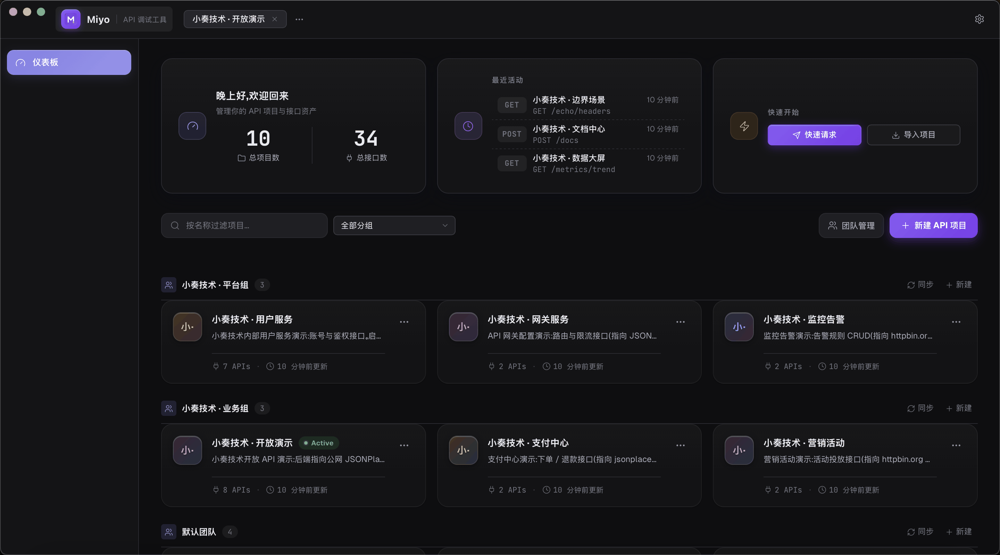

# Miyo

[](https://github.com/weihubeats/Miyo/releases)
[](https://github.com/weihubeats/Miyo/actions/workflows/ci.yml)
[](LICENSE)
[](https://github.com/weihubeats/Miyo/releases)

> A ~10 MB, offline-first API client — debug HTTP / WebSocket / SSE / GraphQL / gRPC, with a built-in mock server, GUI test runner and a CLI for CI. No account. Apache-2.0.

**Download**: [Releases](https://github.com/weihubeats/Miyo/releases) · **Website & docs**: [weihubeats.github.io/Miyo](https://weihubeats.github.io/Miyo/) · **Language**: English · [简体中文](README.zh-CN.md)

<!-- 待系统代理回环修复后重录： -->

## Why Miyo, in one table

| | Miyo | Postman | Bruno | Insomnia |
| --- | --- | --- | --- | --- |
| Installer | **~10 MB** | ~310 MB | ~433 MB | ~200 MB |
| Account | **Not required** | Sign-in pushed | Not required | Sign-in pushed |
| Built-in mock server | **Yes** | Cloud, limited | — | Yes |
| GUI tests + CI CLI | **Yes (JUnit out)** | Via Newman | Via bruno-cli | — |
| Load testing | **Built-in** | Paid plans | — | — |
| License | **Apache-2.0** | Proprietary | MIT | Proprietary |

Full measured table (cold start, memory, app shell) on the [website](https://weihubeats.github.io/Miyo/).

## Highlights

- **Debug** — HTTP, WebSocket, SSE, GraphQL, gRPC; environments with `{{variable}}` interpolation; cURL paste-to-import; multi-tab with per-tab drafts
- **Mock server** — port probing, rules, template variables, delay & fault injection: frontend and backend stop blocking each other
- **Test → CI** — write assertions and variable chains in the GUI, run the collection headlessly with `miyo-cli` (JUnit report, exit-code semantics)
- **Load testing** — concurrency, QPS, P50/P90/P99, built in
- **Local-first security** — everything in a local SQLite file; secrets AES-256-GCM encrypted with a key that never leaves your machine
- **AI Agent integration** — built-in MCP server: save a cURL to Miyo by asking Claude Code / Cursor in one sentence
- **Team sync** — push project snapshots to git / S3 / DB remotes with automatic secret redaction
- **Import** — OpenAPI 3 / Swagger 2 / Postman v2.1 / cURL; undo delete; shortcut help; dark / light / follow-system theme

## Why Miyo?

### 🪶 10 MB, zero runtime dependencies

Competing tools bundle an entire Chromium/Node.js runtime. Miyo is built with **Rust + Tauri 2 + the system WebView** — no bundled browser engine, no Node sandbox, no JRE. Install and go.

| Dimension | Miyo | Postman | Bruno | Insomnia |
| --- | --- | --- | --- | --- |
| Installer size | **~10 MB** | ~310 MB (Electron) | ~433 MB (Electron) | ~200 MB (Electron) |
| Cold start | **< 1 s** | 2–4 s | 2–5 s | 2–4 s |
| Runtime memory | **~40 MB** | ~500 MB+ | ~300 MB+ | ~200 MB+ |
| App shell | System WebView (no bundled Chromium) | Chromium + Node.js | Chromium + Node.js | Chromium + Node.js |

Same workload: **20–40× smaller** installer, **2–5× faster** startup, an order of magnitude less memory.

### ⚡ Fast, without cutting features

Rust LTO + a single-process model + zero-copy SQLite storage — instant open, search, and send. Requests / Mock / testing / load testing are all built in, with no cloud dependency.

### 🔒 Local-first, your data stays yours

Everything lives in a local `miyo.db`; environment variable values are **AES-256-GCM encrypted** at rest. One-click JSON backup, restore anytime.

## Features

### Requests & editing

- 8 HTTP methods, 6 body types (JSON / Form / x-www-form-urlencoded / Multipart / GraphQL / Text)
- Params / Headers / Body / Auth / Tests / Docs tabs; unsaved drafts are flagged automatically
- Paste-to-import cURL: method / URL / headers / body / Basic Auth detected automatically (pasting cURL straight into the address bar parses it into the current request too)
- `{{name}}` variables resolved anywhere (environment > project precedence)

### Auth & security

- API Key / Basic / Bearer / OAuth2 (Authorization Code / Client Credentials / Password / Implicit)
- Tokens attach to requests automatically — no hand-written headers

### Response experience

- Pretty JSON tree / raw / response headers / status / duration / size
- Streaming downloads to disk; request history supports keyword + status search, re-send or delete

### Mock server

- Local axum mock server (port auto-probing from 4010), works fully offline
- **Mock rules** (method + path + header + body matching) take priority; endpoint "response examples" as fallback
- Template variables: `{{params.id}}` `{{headers.X-Token}}` `{{mock.uuid|email|name|word|int}}`

### Automated testing & load testing

- JSON test scripts: `pre_request` variable injection, `extract` capture, `assertions`
- Test cases: multi-case management, list search by name / path / body, live find-highlight for the request body inside the drawer
- Run one endpoint / a folder / the whole project; results and history are kept
- Load testing: concurrency × total requests, with QPS, average latency, P50/P90/P99 and error samples charted via chart.js

### Import / export & collaboration

- OpenAPI 3.x / Swagger 2.0 / Postman Collection v2.1 import and export
- Markdown docs for a single endpoint or the whole project
- Client code generation: cURL / JavaScript / Java / Go / Rust / Python / PHP (variable substitution and auth headers included, syntax highlighted)

### More

- GraphQL debugging view
- Realtime debugging: WebSocket send/receive / SSE subscribe (pop-out window supported)
- Environment import/export (native / Postman), OpenAPI 3.1 import
- Cookie management (inspect/clear per domain, per-request disable), Mock hot-reload & fault injection
- Undo delete, tree multi-select batch ops, shortcut help (Ctrl+/), in-app log viewer
- Backup (JSON) & restore (full ID remapping, never overwrites existing data)
- Configurable data directory (in-app picker or `MIYO_DATA_DIR`, applied on restart)
- Dark / light / follow-system theme
- Headless test runner (`miyo-cli`): run API collections in CI with JUnit output

## AI Agent integration

Miyo ships with a built-in **Agent control plane** (started automatically with the app): a token-protected HTTP API on loopback that lets AI agents (Claude / Cursor / anything that can run commands) save cURL commands as endpoints — no manual copy-paste.

Full guide (`miyo-mcp` setup, client configuration, HTTP API reference, troubleshooting): **[docs/en/AGENT.md](docs/en/AGENT.md)**

### MCP server (recommended)

> **Prerequisite**: MCP needs the `miyo-mcp` binary. Installers since v0.0.10 bundle it, but it is not on PATH — use the absolute path inside the install (macOS: `/Applications/Miyo.app/Contents/MacOS/miyo-mcp`).

For MCP-capable clients such as Claude Code, configure it once in the project `.mcp.json`:

```json
{ "mcpServers": { "miyo": { "command": "/Applications/Miyo.app/Contents/MacOS/miyo-mcp" } } }
```

> A bare `miyo-mcp` works only if the binary is on PATH (Linux .deb install, or a `cargo build --release -p miyo-mcp` copied into `/usr/local/bin`).

Then just ask the AI to save endpoints into Miyo (paste cURL or source code):

```
Save this endpoint to Miyo:
@PostMapping("/orders")
public Result<Long> createOrder(@RequestBody CreateOrderReq req) { ... }
```

Afterwards, say "save this curl to Miyo" in chat. Four tools are provided:

| Tool | Description |
| --- | --- |
| `save_curl` | Parse a cURL command and save it as an endpoint (URL split into base_url + path + query) |
| `list_projects` | List projects |
| `list_endpoints` | List endpoints of a project |
| `agent_info` | Control-plane address and token file location |

### Direct HTTP

Any tool that can send HTTP can call the control plane directly:

| Method | Path | Description |
| --- | --- | --- |
| POST | `/agent/curl` | `{command, projectId?, name?, folderId?}` → endpointId |
| GET | `/agent/projects` | List projects |
| GET | `/agent/endpoints/:projectId` | List endpoints |
| GET | `/agent/health` | Liveness probe |

Auth: header `Authorization: Bearer <token>` or `X-Agent-Token`;
the token lives in the `agent-token` file inside the data directory (0600).

> **Don't confuse the two integrations** (common first-contact mistake):
> the **MCP server is a separate stdio process** — it listens on no port, so
> `GET http://127.0.0.1:<port>/mcp` returning 404 is expected. The HTTP
> control plane is a different surface whose routes all live under `/agent/*`.
>
> The port auto-probes starting at `4110`; the **actual** port is whatever is
> written (plain digits, no newline) in the `agent-port` file inside the data
> directory — e.g. macOS: `cat "$HOME/Library/Application Support/Miyo/agent-port"`.
> Dev builds (`tauri dev`) use the `Miyo-dev` directory, so dev and release
> each have their own `agent-port` / `agent-token` pair.

Security: loopback-only binding; the only write operation is import; existing `base_url` values are never overwritten (a conflict returns a warning).

## Download & install

Grab the installer for your platform from [Releases](https://github.com/weihubeats/Miyo/releases):

| Platform | Installer |
| --- | --- |
| Windows | `Miyo_*-x64-setup.exe` (NSIS; on SmartScreen pick "More info → Run anyway") |
| macOS | `Miyo_*-aarch64.dmg` (Apple Silicon) / `Miyo_*-x64.dmg` (Intel) |
| Linux | `.deb` / `.rpm` / `.AppImage` |

> **macOS: "developer can't be verified" on first launch?** The app is ad-hoc signed but not notarized (no paid Apple Developer cert) — right-click the app → Open to proceed. If an older installer instead says the app is "damaged", run `xattr -cr /Applications/Miyo.app` once. See the [user guide](docs/en/USER_GUIDE.md#12-macos).

After installing, use "About → Check for Updates" in-app to upgrade (auto-update supported since v0.0.3).

## Building from source (developers)

Prerequisites: Rust toolchain + Node 22.

```bash
cargo build --workspace        # build all backend crates
cargo test --workspace         # run all tests
npm --prefix frontend install
npm --prefix frontend run tauri dev     # dev mode (Vite HMR)
scripts/package-tauri.sh                # package distributables in one step
```

> Architecture, crate layout, IPC and data flow: **[docs/en/ARCHITECTURE.md](docs/en/ARCHITECTURE.md)** (Tauri 2 + Vue 3, with diagrams).

## Documentation

**Website**: [https://weihubeats.github.io/Miyo/](https://weihubeats.github.io/Miyo/) — user guide, migration guide, agent integration and changelog, rendered online.

| Document | Description |
| --- | --- |
| [docs/en/README.md](docs/en/README.md) | Docs index (EN; Chinese-only docs marked) |
| [docs/en/ARCHITECTURE.md](docs/en/ARCHITECTURE.md) | Architecture overview (Tauri 2 + Vue 3, with diagrams) |
| [docs/en/USER_GUIDE.md](docs/en/USER_GUIDE.md) | End-user manual |
| [docs/en/AGENT.md](docs/en/AGENT.md) | AI Agent integration (MCP / HTTP control plane) |
| [docs/en/MIGRATION.md](docs/en/MIGRATION.md) | Migration from Apifox / Postman |
| [docs/CLI.md](docs/CLI.md) | Headless CLI test runner (Chinese) |
| [CHANGELOG.md](CHANGELOG.md) | Version highlights (Chinese) |
| [docs/README.md](docs/README.md) | Docs index (Chinese) |
| [docs/SPEC.md](docs/SPEC.md) | Historical spec, frozen (Chinese) |
| [docs/SMOKE_TEST.md](docs/SMOKE_TEST.md) | Manual acceptance checklist (Chinese) |
| [docs/DEPLOY.md](docs/DEPLOY.md) | Release & deployment (Chinese) |
| [docs/MILESTONES.md](docs/MILESTONES.md) | Milestones (Chinese) |
| [docs/PROGRESS.md](docs/PROGRESS.md) | Development progress log (Chinese) |

## License

[Apache-2.0](LICENSE)
