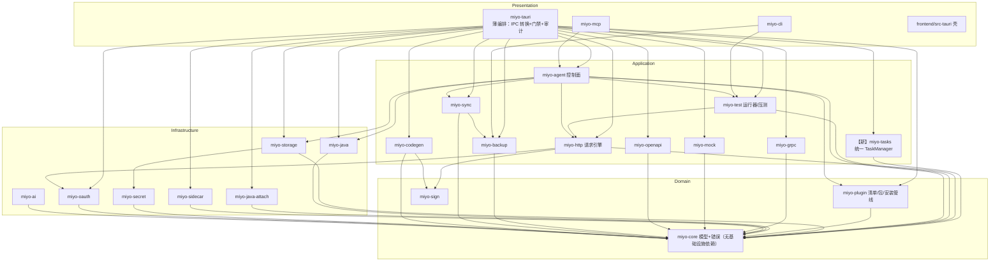

# Miyo 后端目标架构（分层 + 依赖）

> 现状审计见 [AUDIT.md](AUDIT.md)。本文描述重构完成后的目标形态与迁移阻力。

## 目标分层

规则：
- **Domain 不依赖 Infrastructure**：miyo-core 无 sqlx/reqwest/tauri；miyo-plugin 不被 storage 依赖；
- **IPC 面稳定**：命令名/事件名/错误码只增不删；前端不感知 SQLite 结构；
- **命令层 ≤ 编排+门禁+审计**：业务体下沉 Application/Domain（样板：commands/sidecar.rs）；
- **长任务统一走 miyo-tasks**（短生命周期普通 HTTP 请求不改造，仅登记取消令牌）。

## 迁移阻力表

| Crate | 目标层 | 阻力 | 关键动作 |
|---|---|---|---|
| miyo-core | Domain | **中** | 剥离 sqlx/reqwest `#[from]`（Database/Http 改 String 明细，storage/http 边界显式 map） |
| miyo-tauri | Presentation | **高** | 233 命令瘦身（样板 4 个先做）+ 错误码旁路收敛 |
| miyo-storage | Infrastructure | 中 | →plugin 解挂评估（manifest 解析上移） |
| miyo-http | Application | 中 | →storage 解耦评估（trait 注入）；吸收脚本头 reconcile |
| miyo-plugin | Domain | 低 | 吸收安装管线（install.rs） |
| miyo-tasks（新） | Application | – | 见 TASKMANAGER.md |
| miyo-agent | Application | 中 | server.rs 按域拆 handlers |
| miyo-mcp | Presentation | 低 | tools.rs dispatch 拆分 |
| miyo-storage/seed | Infrastructure | 低 | data 常量与编排分离 |
| 其余 | 维持 | 低 | – |

## 已裁决的职责边界

- mock/http/test/backup/sync/codegen/openapi：**无重复**（详见 AUDIT.md 七）；
- 命名混淆项：miyo-smoke ↔ openapi::smoke.rs（冒烟测试 vs 冒烟文档导出）——改名列入路线图；
- 工具清单单源：miyo_agent::registry（mcp/cli 均消费，无清单重复）。

## 不做（本轮）

- 服务端架构 / 分布式（单机调试工具定位）；
- 命令层 36 文件全量瘦身（样板 4 个先行，其余路线图）；
- miyo-http→storage 与 storage→plugin 的强解耦：评估后若牵动过大则标记 deferred。
