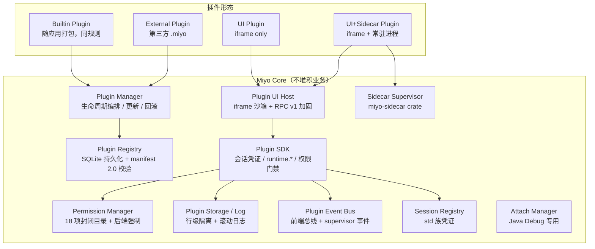

# Miyo 插件架构 2.0

## 总体结构

## 命令族与权限强制矩阵

| 命令族 | 数量 | 后端强制 |
|---|---|---|
| plugin_* 生命周期 / 市场 | 26 | 启用态 + 安装流程校验（签名 / 兼容 / 依赖） |
| plugin_data_* / record_log | 5 | **会话凭证**（plugin_session_create 签发，收权即吊销） |
| plugin_read_asset | 1 | 受管目录 + 拒 symlink + 扩展名白名单 |
| plugin_sidecar_* | 4 | runtime.process.start / stop 权限 |
| plugin_update / rollback / versions | 3 | 安装流程校验 + 快照消费制 |
| java_*（v1 Runtime） | 14 | java.* 子权限（discover/attach/inspect/invoke 按族） |
| java_attach_* / java_agent_*（v2） | 14 | 同上（28/28 全覆盖） |

## 分层职责（与 AGENTS.md 一致）

- `miyo-plugin`：纯逻辑（清单校验 / 包解包 / 签名验签 / 权限目录 / 依赖解析 /
  兼容性）——不做 IPC / DB；
- `miyo-storage`：持久化（插件注册表 / KV / 日志 / 版本历史 / 权限审计）；
- `miyo-sidecar`：常驻插件进程监督（协议 / 握手 / 心跳 / 崩溃恢复 / 平台加固）；
- `miyo-java-attach`：Java Attach 编排（launcher sidecar / Agent 会话表）；
- `miyo-tauri`：命令编排层（门禁 + 审计 + view 组装）——不写业务规则；
- 前端 `plugins/`：SDK / manager / RPC host（防御纵深第一道，**不作为**
  安全面——后端逐命令强制）。

## 不进 Core 的业务边界

Java 调试 / Redis / 数据库 / MQTT / Kafka / Python 工具等均为插件：
Core 只保留宿主管理能力（生命周期 / 权限 / IPC / 存储隔离 / 通知 / 日志 /
UI 宿主 / Sidecar 监督）。

## 边界决策与构建矩阵（2026-11 深度重构补记）

### 核心边界（有意保留在主程序的能力）

HTTP 请求调试、GraphQL 调试、WebSocket/SSE 实时调试、集成测试、AI 测试中心
**为核心能力，不做插件化**（Postman 同构的产品决策：它们是 API 调试工具的
主干工作流，拆出会造成首装即空壳的糟糕体验）。新增能力按以下判据归位：

| 判据 | 归位 |
|---|---|
| API 调试主干工作流（请求/响应/集合/环境） | 核心 |
| 垂直协议/生态调试（Java/Python/DB/Redis/Kafka…） | 插件 |
| 依赖项目上下文但自成闭环的扩展工作流 | 插件（经 SDK ctx.env 访问上下文） |
| 需要原生代码（Rust/JVM attach） | 官方 builtin（feature-gate）或 ui-sidecar |

### Rust 原生能力分发模型（诚实边界）

Rust 无法运行时加载原生代码。第三方插件的原生能力只能以 **ui-sidecar 进程**
形态分发（manifest.sidecar + runtime.process.* 权限，supervisor 全生命周期托管）；
官方插件（Java）的原生宿主层随主程序编译，以 **cargo feature 构建矩阵** 裁剪：

- `miyo-tauri` feature `java`（默认开）：`--no-default-features` 核心构建
  裁掉 AttachManager / 心跳任务 / 30 条 IPC 命令（stub 返回
  `FEATURE_UNAVAILABLE`，命令清单与前端调用面零改动）；
- miyo-agent 控制面共享 mi-java 客户端（v1 runtime 协议），全部经插件门禁，
  AttachManager 注入为 Option——未注入时 attach 模式步骤优雅失败
  （见 ROADMAP.md §3 的后续 feature 化路线）；
- 完全的「运行时安装原生能力」= Java 全量 sidecar 化（ROADMAP.md §1）。

### 生命周期与数据隔离

12 阶段状态机与数据隔离规范见 [LIFECYCLE.md](./LIFECYCLE.md)（唯一对照表）：
卸载确认弹窗提供「保留插件数据」勾选（keepData），深度清理覆盖 per-plugin
文件目录（`{data_dir}/plugin-data/<id>`）、Java 用户数据表、attach 会话、
组件 jar 与 manifest `storage_keys` 声明的 localStorage 前缀。
